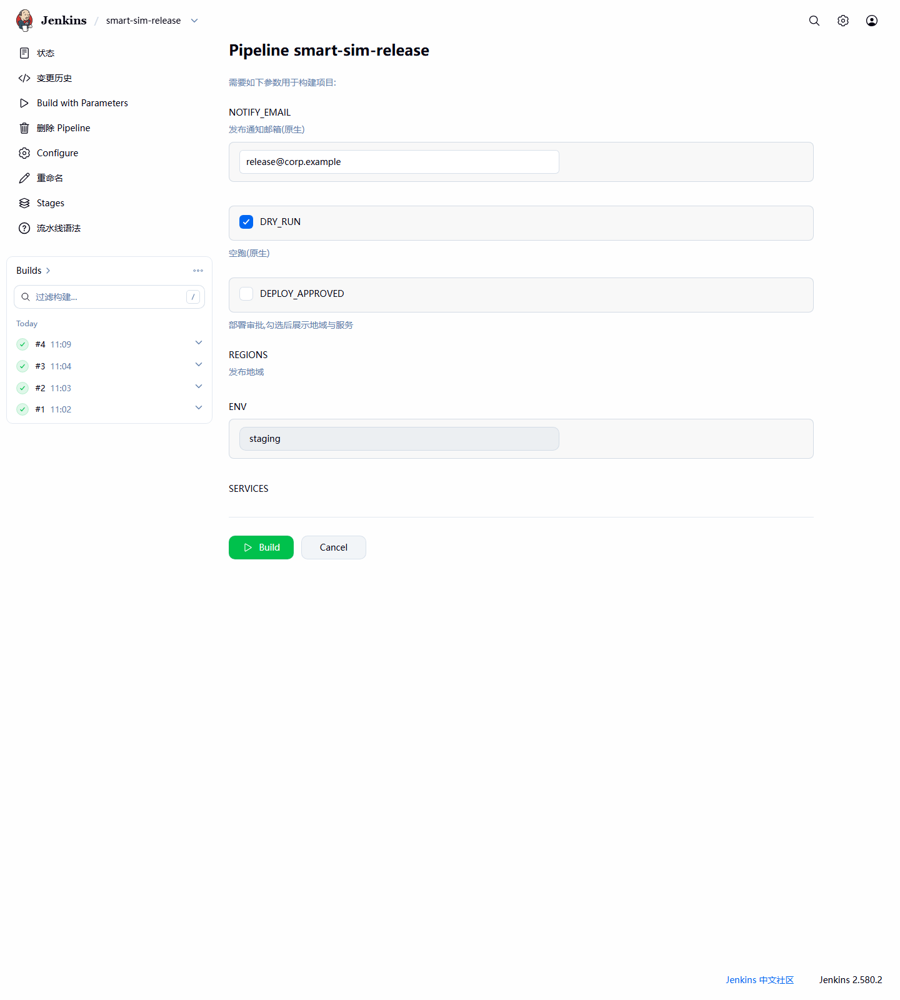
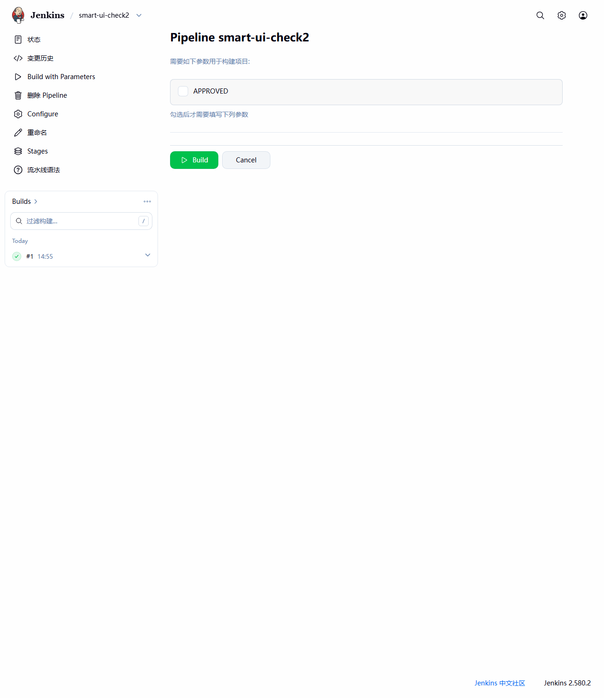
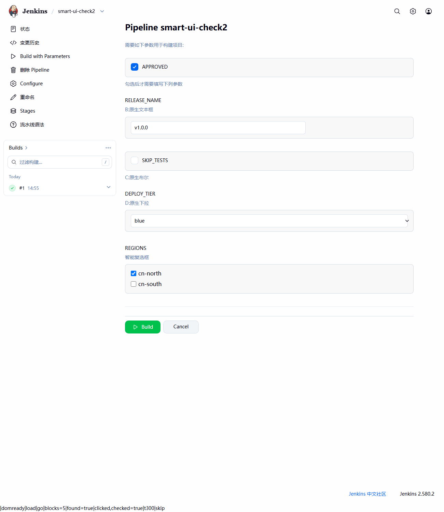
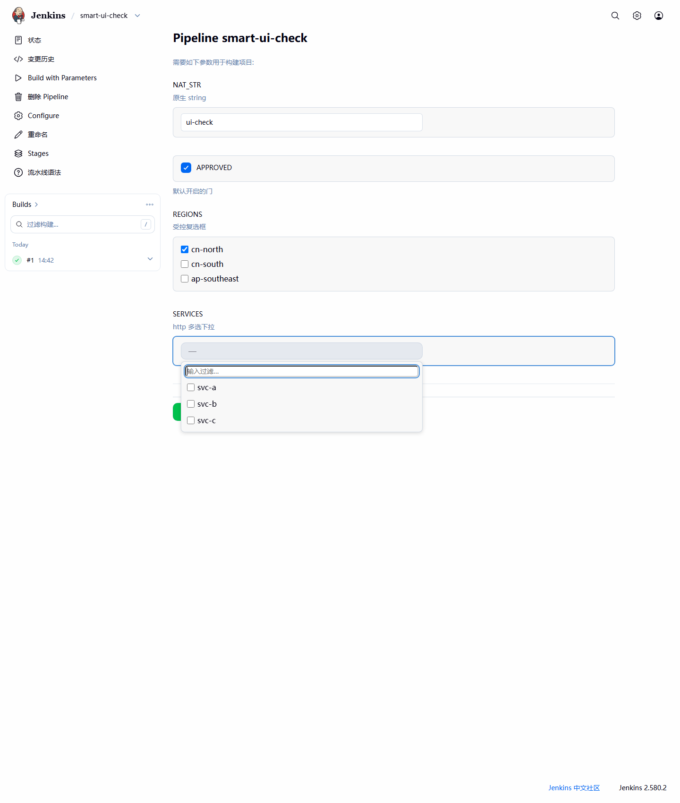
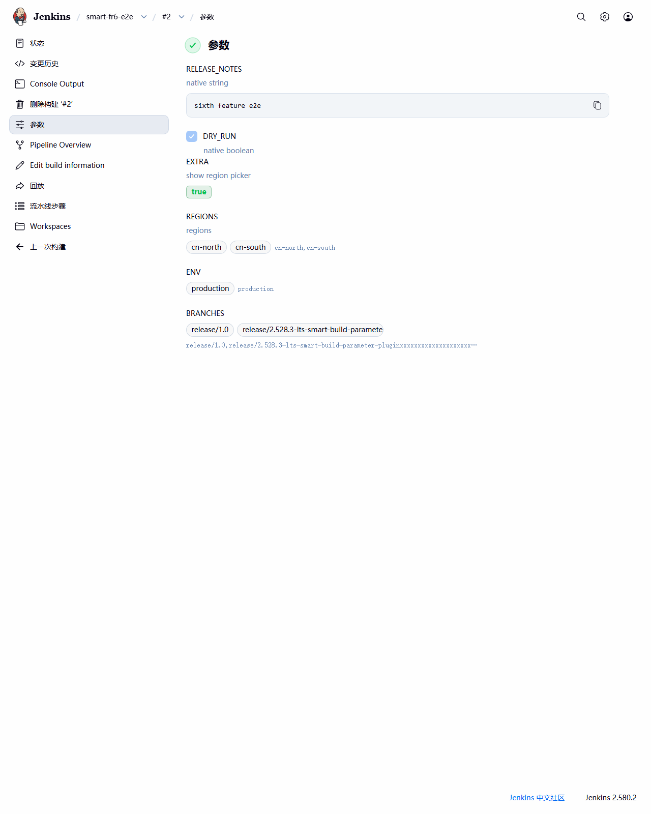

# Smart Build Parameter Plugin

[](https://github.com/zengyongjie/smart-build-parameter-plugin/actions/workflows/ci.yml)
[](LICENSE)
[](https://www.jenkins.io/changelog/)

**English** | [简体中文](README.zh-CN.md)

Smart build parameters for Jenkins pipelines: conditional visibility, multi-select
checkboxes, and dynamic dropdowns fed by shell commands or HTTP APIs — plus a modernized
Build With Parameters page and build-history Parameters page.



All parameter types register both in Pipeline `parameters {}` and in the job-config UI
(*Add Parameter*), and behave like native parameters downstream: `params.NAME` and the
environment variable of the same name.

## Features

| Type | Pipeline symbol | What it does |
| :--- | :--- | :--- |
| Smart Boolean | `smartBoolean` | Checkbox that shows/hides other parameters — of **any** type, native included — on the build page |
| Smart Checkbox | `smartCheckbox` | Multi-select checkboxes; the submitted value is the selection joined with a configurable delimiter |
| Smart Select | `smartSelect` | Filterable dropdown (single/multi) whose options come from a shell command or an HTTP(S) endpoint, evaluated server-side at page render |
| Modern build page | — | Card-style layout for the Build With Parameters form (progressive enhancement, kill switch available) |
| Modern history page | — | True/false badges and per-selection chips on the build's Parameters page |

## Requirements

* Jenkins **2.528 or newer** (developed on the 2.528 LTS line, verified on 2.580 LTS)
* Pipeline users need nothing extra; the plugin has one optional dependency
  (`credentials`) for authenticated HTTP sources

## Installation

Not yet in the Update Center — build from source:

```bash
# JDK 17/21 + Maven 3.9+ …
mvn package
# … or via Docker, no local toolchain required:
docker run --rm --user "$(id -u):$(id -g)" \
  -v "$PWD":/work -v "$HOME/.m2":/var/maven -w /work \
  maven:3.9-eclipse-temurin-21 mvn -B -ntp -Dmaven.repo.local=/var/maven/repository package
```

Upload `target/smart-build-parameter-plugin.hpi` in **Manage Jenkins → Plugins → Advanced
settings → Upload Plugin**, then restart.

## Usage

### Conditional parameters — `smartBoolean`

```groovy
properties([
  parameters([
    smartBoolean(name: 'DEPLOY_APPROVED', defaultValue: false,
                 controls: 'RELEASE_NAME,SKIP_TESTS,DEPLOY_TIER,REGIONS',
                 description: 'Check to reveal the deployment options'),
    string(      name: 'RELEASE_NAME', defaultValue: 'v1.0.0'),
    booleanParam(name: 'SKIP_TESTS',   defaultValue: false),
    choice(      name: 'DEPLOY_TIER',  choices: ['blue', 'green']),
    smartCheckbox(name: 'REGIONS', options: 'cn-north\ncn-south', delimiter: ',')
  ])
])
```

| Unchecked | Checked |
| :---: | :---: |
|  |  |

* `controls` is a comma-separated list of parameter **names** — controlled parameters can be
  any type, native or smart.
* Hidden parameters are **not submitted**: they are absent from the build's
  `ParametersAction`, its Parameters page, and the remote API. On Pipeline, `params.NAME`
  falls back to the job-config default.
* Client-side validation (e.g. `minSelected`) is suspended while a parameter is hidden.
* A `controls` name that does not exist in the job is reported at config time and ignored
  by the build form.
* Cascading visibility (A controls B, B controls C) is not evaluated — a parameter follows
  only the checkbox state of the parameter that names it.

### Multi-select checkboxes — `smartCheckbox`

```groovy
smartCheckbox(name: 'REGIONS',
              options: 'cn-north\ncn-south\ncn-east',  // one per line
              defaultChecked: 'cn-north',              // pre-checked entries
              delimiter: ',',                          // joins the submission
              minSelected: 1,                          // client-side minimum
              description: 'Deploy regions')
```

* The submitted value is the selection joined with `delimiter`, preserving selection order:
  `REGIONS='cn-south,cn-north'`.
* Options must be non-empty, unique, and free of the delimiter; `defaultChecked` entries
  must exist — both validated at config time.
* Remote API: pass the pre-joined string (`build -p REGIONS=cn-north,cn-south`) or a
  structured-form JSON value array. Repeated `NAME=` pairs are rejected by Jenkins core
  for every parameter type.
* The build-history Parameters page renders one chip per selection plus the raw joined
  string.

### Dynamic dropdowns — `smartSelect`

Options are produced by a **source**, evaluated server-side when the build page renders.
The widget is progressive enhancement: without JavaScript it degrades to plain
radio / checkbox controls.

```groovy
properties([
  parameters([
    smartSelect(name: 'BRANCH', selectMode: 'single', defaultValue: 'main',
                source: shell(command: 'git ls-remote --heads https://github.com/jenkinsci/jenkins.git | cut -d/ -f3',
                              cacheTtlSeconds: 60)),
    smartSelect(name: 'SVCS', selectMode: 'multiple', delimiter: ',',
                source: shell(command: 'kubectl get svc -o name', timeoutSeconds: 10)),
    smartSelect(name: 'VERSION',
                source: http(url: 'https://releases.example.com/api/versions')),
    smartSelect(name: 'SERVICE',
                source: http(url: 'https://api.example.com/deployables',
                             responseType: 'jsonPath', jsonPath: 'data.items[*].name',
                             authType: 'bearer', credentialsId: 'api-token'))
  ])
])
```



* `selectMode`: `single` (default) or `multiple`; `filterable` (default `true`) adds an
  instant client-side substring filter.
* Multi-select value semantics match `smartCheckbox` (delimiter-joined string, selection
  order preserved).
* Sources are configured in the job-config **Advanced** section:
  * `shell(command, timeoutSeconds = 5, cacheTtlSeconds = 0, maxOutputBytes = 64 KiB)` —
    runs `/bin/sh -c` **on the controller**, one option per output line (trimmed, blank
    lines and duplicates dropped).
  * `http(url, timeoutSeconds = 10, cacheTtlSeconds = 0, maxOutputBytes = 64 KiB,
    authType = none|basic|bearer, credentialsId, responseType = jsonArray|jsonPath|textLines,
    jsonPath)` — `java.net.http.HttpClient`; `jsonPath` accepts one `[*]` expansion such
    as `data.items[*].name`.
* Authentication goes through the Jenkins **credential store** only — `basic` uses a
  username/password credential, `bearer` a secret text sent as `Authorization: Bearer …`.
  Secrets never appear in pages, logs, or error messages.
* `cacheTtlSeconds` caches successful output per window; failures are never cached.
* A failing source (non-zero exit, HTTP error, timeout, output over the limit, invalid
  payload) renders an inline error with a **Retry** button instead of breaking the page;
  the parameter renders no value control in that state, so it cannot be submitted, while
  the other parameters keep working.

### Modern pages

* **Build With Parameters**: card-style grouping per parameter, unified control styling,
  rebuilt action bar. Injected by a `PageDecorator` that appends the plugin's own scoped
  CSS/JS for the build form only — no core template is overridden, and without the script
  the page is the fully functional native form. Disable anytime with
  `-Dio.github.xvvx.smartbuildparameter.modernBuildPage=false` (read per render, so it can
  be toggled at runtime via the script console); when off, nothing is injected.
* **Build-history Parameters**: plugin values render as true/false badges and
  per-selection chips (long values truncate, full text on hover). Native parameters keep
  core's rendering untouched, and the remote API keeps the conventional `name`/`value`
  shape.



## Building & testing

```bash
mvn verify          # compile + tests (JUnit 5, JenkinsRule) + SpotBugs
mvn hpi:run         # local Jenkins at http://localhost:8080/jenkins with the plugin loaded
mvn test -Dtest=SmartSelectParameterDefinitionTest          # single class
mvn test -Dtest=SmartBooleanParameterDefinitionTest#configRoundtrip  # single method
```

The design document ([`docs/REQUIREMENTS.md`](docs/REQUIREMENTS.md), 中文) and the test
plan with execution records ([`docs/TEST_PLAN.md`](docs/TEST_PLAN.md), 中文) document the
behavioral contract and the 72 automated tests.

## License

[MIT](LICENSE)
