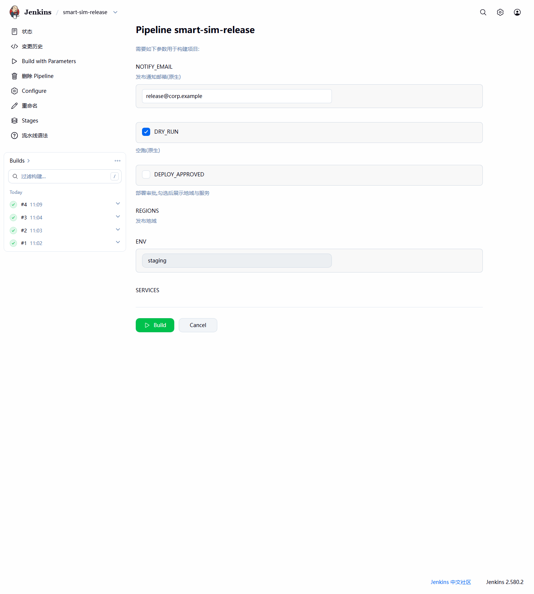
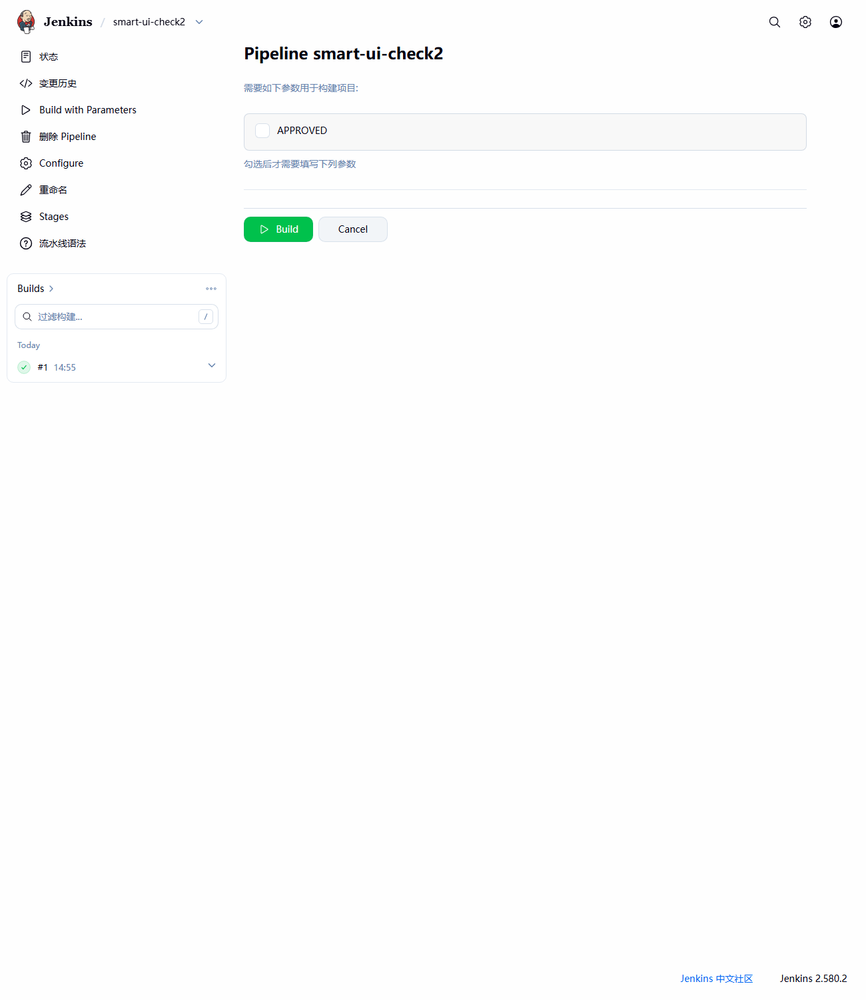
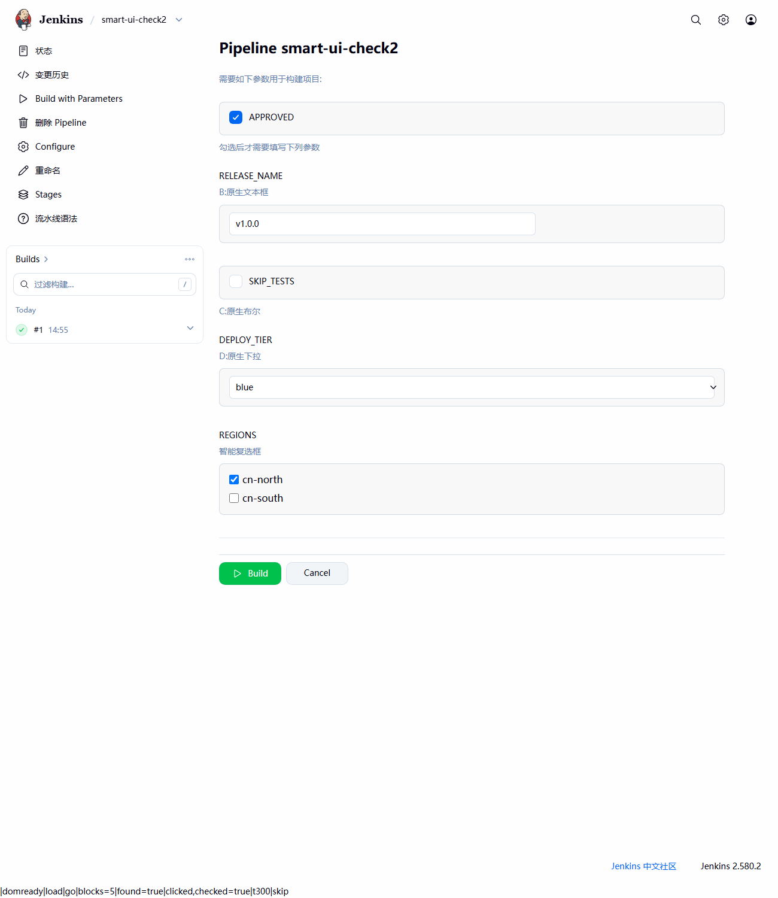
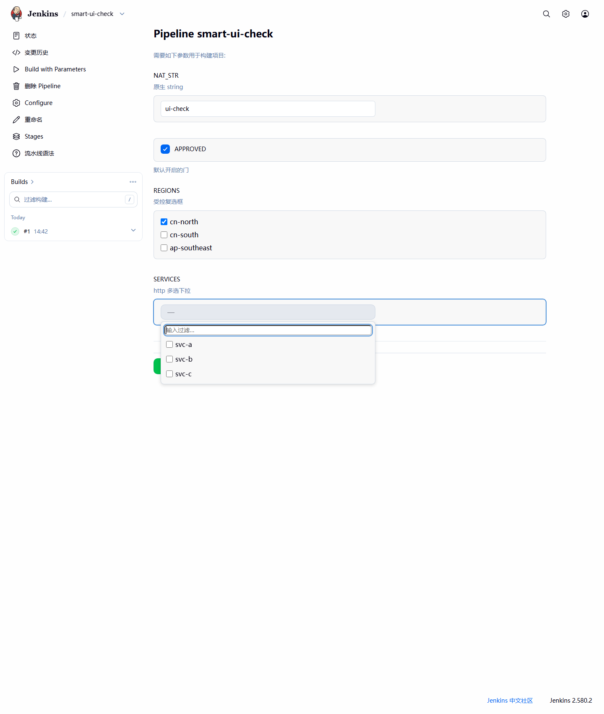
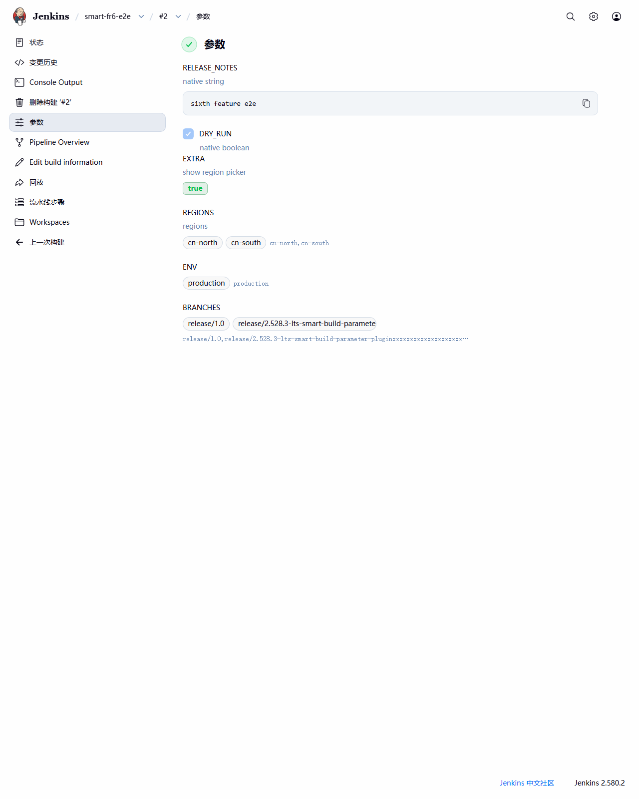

# Smart Build Parameter 插件

[](https://github.com/zengyongjie/smart-build-parameter-plugin/actions/workflows/ci.yml)
[](LICENSE)
[](https://www.jenkins.io/changelog/)

[English](README.md) | **简体中文**

面向 Jenkins 流水线的智能构建参数：条件显隐开关、多选复选框、由 Shell 命令或 HTTP 接口
动态取值的下拉框，以及现代化的 Build With Parameters 页面与构建历史 Parameters 页面。



所有参数类型同时注册到 Pipeline 的 `parameters {}` 与任务配置界面的 *Add Parameter*，
下游行为与原生参数完全一致：`params.NAME` 与同名环境变量。

## 功能

| 类型 | Pipeline 符号 | 说明 |
| :--- | :--- | :--- |
| 智能布尔 | `smartBoolean` | 勾选/取消时在构建页显示或隐藏其他参数——**任意类型**，含原生参数 |
| 智能复选框 | `smartCheckbox` | 多选；提交值为按可配置分隔符拼接的字符串 |
| 智能下拉框 | `smartSelect` | 可过滤的单选/多选下拉，选项来自 Shell 命令或 HTTP(S) 接口，在页面渲染时由服务端求值 |
| 现代构建页 | — | Build With Parameters 表单的卡片式布局（渐进增强，可一键关闭） |
| 现代历史页 | — | 构建的 Parameters 页面以徽章与 chip 展示参数值 |

## 环境要求

* Jenkins **2.528 及以上**（基于 2.528 LTS 线开发，在 2.580 LTS 上验证）
* Pipeline 用户无需额外依赖；插件仅有一个可选依赖（`credentials`，用于带认证的 HTTP 源）

## 安装

尚未发布到 Update Center，请从源码构建：

```bash
# JDK 17/21 + Maven 3.9+ …
mvn package
# … 或通过 Docker，本地无需任何工具链：
docker run --rm --user "$(id -u):$(id -g)" \
  -v "$PWD":/work -v "$HOME/.m2":/var/maven -w /work \
  maven:3.9-eclipse-temurin-21 mvn -B -ntp -Dmaven.repo.local=/var/maven/repository package
```

在 **Manage Jenkins → Plugins → Advanced settings → Upload Plugin** 上传
`target/smart-build-parameter-plugin.hpi` 后重启即可。

## 用法

### 条件参数 —— `smartBoolean`

```groovy
properties([
  parameters([
    smartBoolean(name: 'DEPLOY_APPROVED', defaultValue: false,
                 controls: 'RELEASE_NAME,SKIP_TESTS,DEPLOY_TIER,REGIONS',
                 description: '勾选后展开部署选项'),
    string(      name: 'RELEASE_NAME', defaultValue: 'v1.0.0'),
    booleanParam(name: 'SKIP_TESTS',   defaultValue: false),
    choice(      name: 'DEPLOY_TIER',  choices: ['blue', 'green']),
    smartCheckbox(name: 'REGIONS', options: 'cn-north\ncn-south', delimiter: ',')
  ])
])
```

| 未勾选 | 勾选后 |
| :---: | :---: |
|  |  |

* `controls` 是逗号分隔的参数**名**列表——受控参数可以是任意类型，原生或智能均可。
* 隐藏的参数**不会提交**：不出现在构建的 `ParametersAction`、Parameters 页面与远程
  API 中；Pipeline 里 `params.NAME` 回退到任务配置的默认值。
* 参数隐藏期间，客户端校验（如 `minSelected`）暂停生效。
* `controls` 里不存在的参数名在配置时告警，构建表单忽略之。
* 不做级联显隐（A 控 B、B 控 C 不联动）——每个参数只跟随点名它的那个开关的勾选状态。

### 多选复选框 —— `smartCheckbox`

```groovy
smartCheckbox(name: 'REGIONS',
              options: 'cn-north\ncn-south\ncn-east',  // 每行一个
              defaultChecked: 'cn-north',              // 默认勾选项
              delimiter: ',',                          // 提交值的分隔符
              minSelected: 1,                          // 客户端最少勾选数
              description: '发布区域')
```

* 提交值为勾选项按 `delimiter` 拼接的字符串，保持勾选顺序：
  `REGIONS='cn-south,cn-north'`。
* 选项须非空、不重复、不含分隔符；`defaultChecked` 必须存在于选项中——均在配置时校验。
* 远程 API：传拼接后的字符串（`build -p REGIONS=cn-north,cn-south`）或结构化表单 JSON
  数组；重复的 `NAME=` 参数会被 Jenkins core 拒绝（所有参数类型均如此）。
* 构建历史 Parameters 页面按勾选项渲染 chip，并附原始拼接字符串。

### 动态下拉框 —— `smartSelect`

选项由**源（source）**产生，在构建页渲染时由服务端求值。前端组件为渐进增强：
禁用 JavaScript 时退化为原生 radio / checkbox。

```groovy
properties([
  parameters([
    smartSelect(name: 'BRANCH', selectMode: 'single', defaultValue: 'main',
                source: shell(command: 'git ls-remote --heads https://github.com/jenkinsci/jenkins.git | cut -d/ -f3',
                              cacheTtlSeconds: 60)),
    smartSelect(name: 'SVCS', selectMode: 'multiple', delimiter: ',',
                source: shell(command: 'kubectl get svc -o name', timeoutSeconds: 10)),
    smartSelect(name: 'VERSION',
                source: http(url: 'https://releases.example.com/api/versions')),
    smartSelect(name: 'SERVICE',
                source: http(url: 'https://api.example.com/deployables',
                             responseType: 'jsonPath', jsonPath: 'data.items[*].name',
                             authType: 'bearer', credentialsId: 'api-token'))
  ])
])
```



* `selectMode`：`single`（默认）或 `multiple`；`filterable`（默认 `true`）提供即时
  客户端子串过滤。
* 多选的取值语义与 `smartCheckbox` 一致（分隔符拼接字符串，保持勾选顺序）。
* 源在任务配置的 **Advanced** 区配置：
  * `shell(command, timeoutSeconds = 5, cacheTtlSeconds = 0, maxOutputBytes = 64 KiB)` —
    在**控制器**上执行 `/bin/sh -c`，每行输出一个选项（去除首尾空白，丢弃空行与重复项）。
  * `http(url, timeoutSeconds = 10, cacheTtlSeconds = 0, maxOutputBytes = 64 KiB,
    authType = none|basic|bearer, credentialsId, responseType = jsonArray|jsonPath|textLines,
    jsonPath)` — 基于 `java.net.http.HttpClient`；`jsonPath` 支持一次 `[*]` 展开，
    如 `data.items[*].name`。
* 认证只走 Jenkins **凭证库**——`basic` 用用户名/密码凭证，`bearer` 用 secret text 并以
  `Authorization: Bearer …` 发送。密钥不会出现在任何页面、日志或错误信息中。
* `cacheTtlSeconds` 按时间窗缓存成功结果；失败永不缓存。
* 源失败（非零退出码、HTTP 错误、超时、输出超限、载荷非法）时渲染内联错误与
  **Retry** 按钮，不会破坏整个页面；该参数此时不渲染取值控件（不会被提交），其余参数
  照常工作。

### 现代化页面

* **Build With Parameters**：每个参数一张卡片、统一的控件样式、重排的操作栏。由一个
  `PageDecorator` 仅为构建表单追加插件自有的受限作用域 CSS/JS 实现——不覆盖任何核心
  模板；脚本缺失时页面即完整可用的原生表单。随时可用
  `-Dio.github.xvvx.smartbuildparameter.modernBuildPage=false` 关闭（每次渲染读取，
  可通过 script console 运行时切换）；关闭后完全不注入。
* **构建历史 Parameters**：插件参数值渲染为 true/false 徽章与逐项 chip（超长截断，悬停
  显示全文）。原生参数保持核心渲染不变，远程 API 也保持传统的 `name`/`value` 形态。



## 构建与测试

```bash
mvn verify          # 编译 + 测试（JUnit 5, JenkinsRule）+ SpotBugs
mvn hpi:run         # 本地 Jenkins：http://localhost:8080/jenkins，插件已加载
mvn test -Dtest=SmartSelectParameterDefinitionTest          # 单个测试类
mvn test -Dtest=SmartBooleanParameterDefinitionTest#configRoundtrip  # 单个方法
```

设计文档（[`docs/REQUIREMENTS.md`](docs/REQUIREMENTS.md)）与含执行记录的测试计划
（[`docs/TEST_PLAN.md`](docs/TEST_PLAN.md)）记录了行为契约与 72 个自动化测试。

## 许可证

[MIT](LICENSE)
